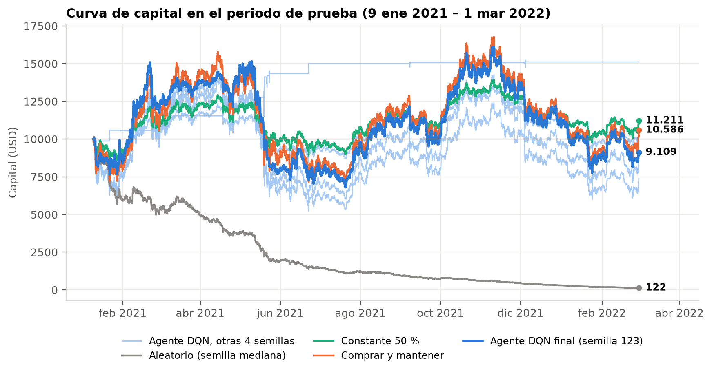

# Agente inversor DQN sobre BTC/USD

Proyecto final del curso Simulación y Aprendizaje por Refuerzo MIA 2026-5 (Maestría en Inteligencia Artificial, Universidad de La Sabana), profesor Emilio Muñoz Pérez. Grupo 4.

Un agente de aprendizaje por refuerzo decide cada hora qué fracción del capital tener en Bitcoin (0 %, 50 % o 100 %). Aprende con datos históricos y se evalúa una sola vez en un periodo que nunca vio, contra estrategias simples.

**Pregunta:** ¿puede un agente DQN aprender una estrategia de inversión que se comporte mejor que estrategias simples en datos no vistos?

**Respuesta corta:** en este experimento, no. El agente elegido en validación perdió 8,91 % en la prueba, con una caída máxima de 55,20 %. En el mismo periodo, comprar y mantener ganó 5,86 % y mantener siempre el 50 % ganó 12,11 %. El agente aleatorio perdió 98,8 %, casi todo en comisiones. El informe explica por qué pasó esto y qué se aprendió en el camino.

## Resultados en el periodo de prueba (9 ene 2021 – 1 mar 2022, 9.971 horas)

| Estrategia | Retorno acumulado | Máximo drawdown | Costos de transacción | Cambios de exposición |
|---|---:|---:|---:|---:|
| Agente DQN final (R1 sin escalar, semilla 123) | −8,91 % | −55,20 % | 425,68 USD | 65 |
| Agente DQN, mediana de las 5 semillas | −8,91 % | −55,20 % | 545,33 USD | 65 |
| Comprar y mantener | +5,86 % | −54,83 % | 9,99 USD | 1 |
| Constante 50 % (referencia extra) | +12,11 % | −31,03 % | 168,85 USD | 1 |
| Aleatorio (mediana de 100 semillas) | −98,79 % | −98,89 % | 10.483,17 USD | 6.653 |

Capital inicial de 10.000 USD y costo de 0,1 % sobre el monto operado en todas las estrategias. Las medianas se calculan columna por columna. Tablas completas en `resultados/prueba/` y figuras en `resultados/figuras/`.



## Datos

- Archivo: `data/BTC_USD-Hourly.csv`, copia del dataset público de Gym-Trading-Env: <https://raw.githubusercontent.com/ClementPerroud/Gym-Trading-Env/main/examples/data/BTC_USD-Hourly.csv>
- SHA-256: `b5ccfdef2aa852ded1ea03378c1777757d2c27a81d53e0fc81af0011fed9cccf` (el código lo comprueba antes de usarlo).
- 33.259 horas, del 15/05/2018 06:00 al 01/03/2022 00:00 UTC. Tras quitar las primeras 24 horas sin historia quedan 33.235.
- División cronológica, sin mezclar:

| Periodo | Horas | Fechas (UTC) | Uso |
|---|---:|---|---|
| Ajuste | 18.611 | 16/05/2018 06:00 – 29/06/2020 16:00 | el agente aprende |
| Validación | 4.653 | 29/06/2020 17:00 – 09/01/2021 13:00 | elegir la versión del agente |
| Prueba | 9.971 | 09/01/2021 14:00 – 01/03/2022 00:00 | evaluación final, una sola vez |

Ajuste y validación forman el 70 % de entrenamiento; la prueba es el 30 % final.

## Formulación en una tabla

| Elemento | Definición |
|---|---|
| Estado | `return_24h`, `price_vs_sma_24h`, `volatility_24h` (ventanas de 24 h hacia atrás) y la fracción actual en BTC |
| Acciones | 0 → 0 % en BTC, 1 → 50 %, 2 → 100 %. Sin apalancamiento ni ventas en corto |
| Momento de la decisión | se observa el cierre de la hora *t*, se opera al cierre de *t* y el resultado se mide con el cierre de *t+1* |
| Costo | 0,1 % sobre el monto comprado o vendido (incluye el rebalanceo para mantener el 50 %) |
| R1 | ln(V<sub>t+1</sub>/V<sub>t</sub>), retorno logarítmico neto de costos |
| R2 | R1 − 0,5·R1², castiga el riesgo |
| R3 | R2 − κ·\|w<sub>t</sub> − w<sub>t−1</sub>\|, castiga además cambiar de exposición (κ = 0,002; 0,005; 0,010) |
| Agente | DQN de Stable-Baselines3, red 4 → 64 → 64 → 3 (ReLU), 120.000 pasos |

## Instalación

Requiere Python 3.12 o 3.13. Con [uv](https://docs.astral.sh/uv/):

```bash
git clone https://github.com/dsiriarte/agente-inversor-btc.git
cd agente-inversor-btc
uv sync --extra notebooks
```

Sin uv:

```bash
python3.13 -m venv .venv
source .venv/bin/activate          # Windows: .venv\Scripts\activate
pip install -r requirements.txt
```

En lo que sigue, `python` es el de ese entorno (`uv run python` o `.venv/bin/python`).

## Cómo reproducir

Todo de una vez, con los modelos ya entrenados que trae el repositorio (menos de 2 minutos):

```bash
python -m src.pipeline
```

Reentrenando los 30 modelos desde cero (unos 3 minutos con 8 núcleos):

```bash
python -m src.pipeline --entrenar
```

Paso a paso:

| Paso | Comando | Qué hace |
|---|---|---|
| Datos | `python -m src.data` | prepara indicadores y divisiones, audita *lookahead* y guarda `data/procesados/` |
| Entrenamiento | `python -m src.train --todos` | 6 experimentos × 5 semillas, solo con el periodo de ajuste |
| Un solo modelo | `python -m src.train --experimento R1_sin_escalar --semilla 123` | |
| Baselines | `python -m src.baselines --conjunto validacion` | comprar y mantener, constante 50 % y 100 semillas del aleatorio |
| Validación y selección | `python -m src.evaluate --validacion` | compara los experimentos y congela la selección en `configs/seleccion.json` |
| Evaluación final | `python -m src.evaluate --prueba` | evalúa el agente elegido y los baselines en la prueba |
| Análisis posterior | `python -m src.evaluate --posterior` | los demás experimentos en prueba, solo para la discusión |
| Auditoría | `python -m src.auditoria` | comprueba que ninguna decisión usa información futura |
| Figuras | `python -m src.figuras` | genera `resultados/figuras/` |
| EDA | `jupyter notebook notebooks/eda.ipynb` | análisis exploratorio |

## Semillas y determinismo

- Agente: semillas 42, 123, 456, 789 y 2026 (`configs/base.json`). Cada una fija Python, NumPy, PyTorch y Stable-Baselines3; PyTorch corre con un solo hilo.
- Agente aleatorio: semillas 1000 a 1099.
- En un mismo computador, reentrenar da exactamente los mismos pesos (comprobado). En otra máquina o sistema operativo los pesos pueden variar en los últimos decimales y, como el agente es muy sensible, la política puede cambiar. Por eso el repositorio incluye los modelos entrenados (`modelos/*/semilla_*/modelo_final.zip`) y la huella SHA-256 de sus pesos en `configs/seleccion.json`. `--prueba` avisa si los pesos no son los congelados. Se comprobó desde un clon limpio que reentrenar en el mismo computador reproduce los mismos pesos y exactamente las mismas tablas y figuras.
- Versiones usadas: Python 3.13.5, torch 2.11.0, gymnasium 1.3.0, stable-baselines3 2.9.0, numpy 2.1.3, pandas 3.0.6 (`uv.lock`).

## Protocolo de evaluación

1. El agente aprende solo con el periodo de ajuste. El escalado del estado (cuando se usa) toma media y desviación solo de ese periodo.
2. Las versiones se comparan en validación con una regla escrita antes de entrenar R3 (`configs/base.json` → `seleccion`): se descartan las que caen más que comprar y mantener y gana la de mayor retorno mediano.
3. La decisión queda congelada en `configs/seleccion.json`, con fecha y huella de los modelos, antes de tocar la prueba.
4. La prueba se evalúa una vez. Los demás experimentos se evalúan después en prueba solo para la discusión (`resultados/prueba_posterior/`), sin cambiar la selección.

Aviso de transparencia: en la primera etapa del proyecto (`notebooks/historico/primera_version.ipynb`) se evaluó un DQN preliminar en este mismo periodo de prueba. Ningún hiperparámetro del agente final se ajustó con esos resultados, pero el periodo ya había sido visto.

## Estructura

```
agente-inversor-btc/
├── data/BTC_USD-Hourly.csv        dataset original
├── src/
│   ├── data.py                    procesamiento de datos y auditoría de indicadores
│   ├── environment.py             entorno Gymnasium (0/50/100 %, costos, recompensa)
│   ├── rewards.py                 recompensas R1, R2 y R3
│   ├── agent.py                   DQN de Stable-Baselines3 y semillas
│   ├── baselines.py               comprar y mantener, constante 50 %, aleatorio
│   ├── train.py                   entrenamiento y validación
│   ├── evaluate.py                selección congelada y evaluación en prueba
│   ├── metrics.py                 retorno, drawdown, costos, exposición
│   ├── auditoria.py               pruebas de información futura y contabilidad
│   ├── figuras.py                 figuras del informe
│   └── pipeline.py                todo en orden
├── configs/                       base.json, experimentos.json, seleccion.json
├── modelos/                       modelos finales por experimento y semilla
├── resultados/                    tablas, historiales y figuras
├── notebooks/
│   ├── eda.ipynb                  análisis exploratorio
│   └── historico/primera_version.ipynb   primera versión del proyecto (registro)
├── informe/                       informe del proyecto (Word)
├── pyproject.toml, uv.lock, requirements.txt
└── README.md
```

## Autores

Grupo 4, Simulación y Aprendizaje por Refuerzo MIA 2026-5, Universidad de La Sabana.

## Referencias

- ClementPerroud. (s. f.). *Gym-Trading-Env* [Repositorio de código]. GitHub. <https://github.com/ClementPerroud/Gym-Trading-Env>
- Farama Foundation. (s. f.). *Gymnasium documentation*. <https://gymnasium.farama.org/>
- Mnih, V., Kavukcuoglu, K., Silver, D., Rusu, A. A., Veness, J., Bellemare, M. G., Graves, A., Riedmiller, M., Fidjeland, A. K., Ostrovski, G., Petersen, S., Beattie, C., Sadik, A., Antonoglou, I., King, H., Kumaran, D., Wierstra, D., Legg, S., & Hassabis, D. (2015). Human-level control through deep reinforcement learning. *Nature, 518*(7540), 529–533. <https://doi.org/10.1038/nature14236>
- Raffin, A., Hill, A., Gleave, A., Kanervisto, A., Ernestus, M., & Dormann, N. (2021). Stable-Baselines3: Reliable reinforcement learning implementations. *Journal of Machine Learning Research, 22*(268), 1–8. <http://jmlr.org/papers/v22/20-1364.html>
- Sutton, R. S., & Barto, A. G. (2018). *Reinforcement learning: An introduction* (2.ª ed.). MIT Press.
